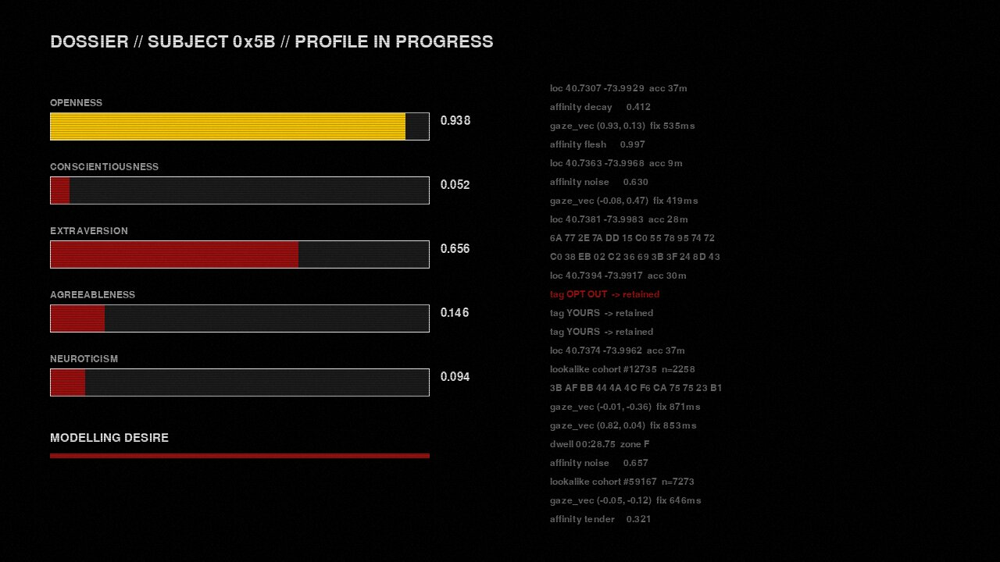
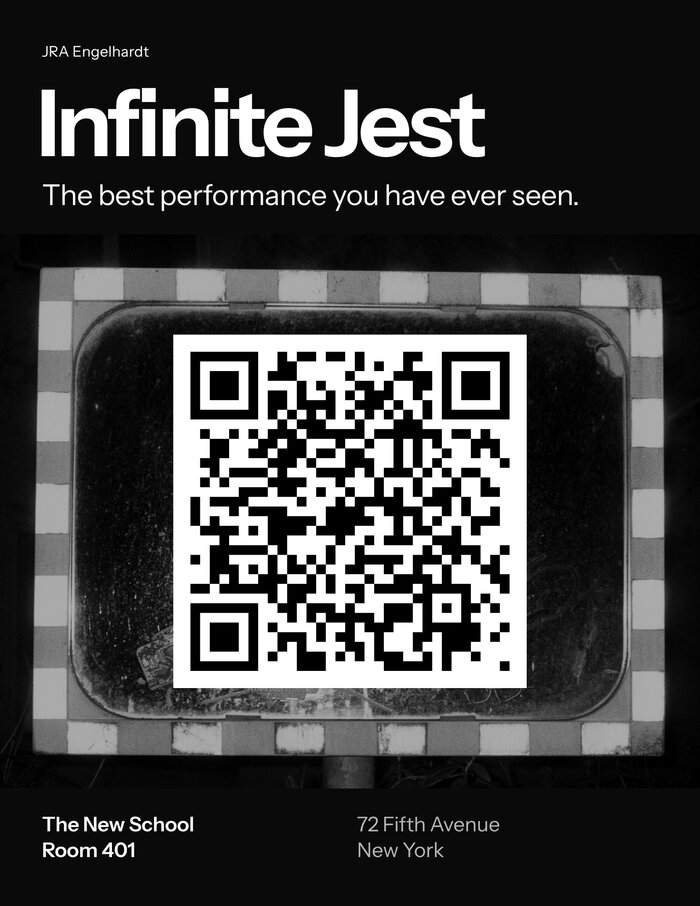

# INFINITE JEST

**A performance installation by J R A. Room 401, The New School, 72 Fifth Avenue, New York.
Dec 9 to Dec 22, 2026, 12:00 to 22:00, closed Saturdays.**

*The best performance you have ever seen.*

Infinite Jest is an automated, adaptive performance that runs on a small computer
hidden in the room. It reads each visitor and plays to them: the images, the music,
the words and the questions shift until it finds what holds that one person. It is a
piece about dark data and custom-made intimacy. The method it borrows, personality
profiling from a digital footprint, is the method behind the Cambridge Analytica
scandal. Here it is done in plain sight, to people who agreed to it, and it still goes
too far.

Status (Nov 24, 2026): running on the Raspberry Pi in test; install in room 401 the
week of Dec 4; first visitors Dec 9. Book at
[jasperengelhardt.com/visit.html](https://jasperengelhardt.com/visit.html).

## The concept

One person at a time stands on a marked spot in a dark room facing a screen. The room
has already looked them up (every guest agrees to this when booking). From the
moment they enter, it watches how they stand, move, speak and fall silent, and it
adapts.

- **It never resets while you stay.** A visit is one long arc, not a loop. Leave and the
  room forgets you.
- **Waves.** The music and the picture move in tides of two and a half to five and a half
  minutes: they build, swell and ebb together, so the room breathes.
- **A conversation.** The room asks a question, listens for about eleven seconds, and
  answers. It only notices *whether* and *how long* you spoke, never what you said: the
  microphone measures loudness and voice activity and records nothing.
- **It never repeats a sentence.** Every line is new. A small local language model writes
  fresh lines live, around a bank of hand-written ones.
- **Family footage.** Donated home movies from a family archive are the main imagery,
  cut into a moving collage with the room's own paintings, the guest's public pictures
  and the live camera.
- **A face that grows.** After a couple of minutes of presence, a small neural network
  slowly grows a face on the screen, in bursts, while the visitor stays still.
- **A daily mood.** Each day the room wakes in a different mood (dread, boredom, calm,
  wonder, longing, fear, elation) that colours everything it says that day.
- **Five rooms.** Inside the performance the imagery moves between five scenes:
  *the wound*, *the writing*, *the fall*, *the mirror* and *the dark*. A learning loop
  (a bandit) tries them and stays with what holds the visitor longest compared with
  their own baseline.
- **The reveal.** Near the end the room shows the visitor what it thinks it knows about
  them, then says it is all being deleted.

## Contents

| | |
|---|---|
| [Samples](docs/samples.md) | Music and stills from the Pi |
| [Room 401](docs/room-401.md) | Photos of the room, floor plan, installation plan |
| [OCEAN and Cambridge Analytica research](docs/research.md) | How the profiling works, and what we tested |
| [Technical breakdown](docs/technical.md) | Hardware, software and every AI model on the Pi |
| [The shell](docs/shell.md) | The 3D-printed "stone" case for the Pi |
| [The booking tool](docs/booking.md) | The sign-up page, terms and booking list |
| [References](docs/references.md) | Research, sources and software |
| [Earlier concept](docs/archive/read-the-room-concept.md) | *Read the Room*, Oct 2026 (superseded) |

## Where the code is

The work is being built in parallel branches, each with an open pull request, and
merged as each part is tested on the Pi:

| Part | Folder | Pull request |
|---|---|---|
| Show engine (the Pi app, two screens, conversation, mood) | `infinite_jest/pi`, `infinite_jest/dream` | [#4](https://github.com/Grossi-thisisforyou/read_the_room/pull/4) |
| Interface contract | `docs/CONTRACT.md` | [#5](https://github.com/Grossi-thisisforyou/read_the_room/pull/5) |
| Case and boot splash | `infinite_jest/case` | [#6](https://github.com/Grossi-thisisforyou/read_the_room/pull/6) |
| Profiler and local language model voice | `infinite_jest/profiler`, `infinite_jest/oracle` | [#8](https://github.com/Grossi-thisisforyou/read_the_room/pull/8) |
| Visuals and music | `infinite_jest/visuals`, `infinite_jest/audio` | [#9](https://github.com/Grossi-thisisforyou/read_the_room/pull/9) |
| The written voice | `infinite_jest/text` | [#10](https://github.com/Grossi-thisisforyou/read_the_room/pull/10) |
| All modules together, simulated visits | `infinite_jest/integration` | [#11](https://github.com/Grossi-thisisforyou/read_the_room/pull/11) |
| Offline install, network, watchdog | `infinite_jest/deploy` | [#12](https://github.com/Grossi-thisisforyou/read_the_room/pull/12) |

The booking page lives in the website repo,
[Grossi-thisisforyou/jasperengelhardt](https://github.com/Grossi-thisisforyou/jasperengelhardt).

## Privacy, in short

- All AI runs on the Pi, offline. Nothing from the room goes to the internet.
- The camera image stays in memory only. The microphone measures level and voice
  activity and is never recorded or transcribed.
- Everything about a visit is wiped when the visitor leaves.
- Guest research uses public material only and is deleted on Dec 23, 2026. No guest
  data is in this repository.
- The family footage is read from a USB stick in the room and is not in this repository.

Made at Parsons School of Design, The New School, Fall 2026, in the course
*Small Linux Devices, Large Language Models*. Built with the help of Claude (Anthropic).
