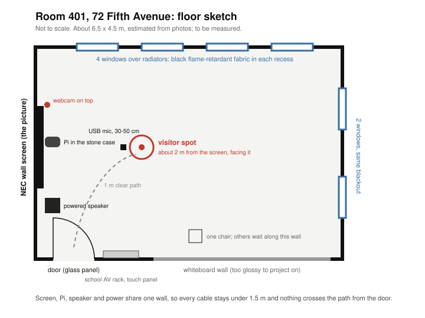
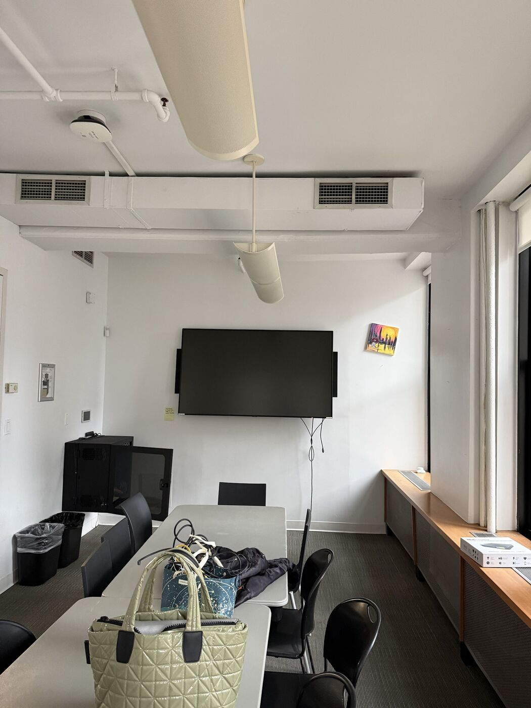
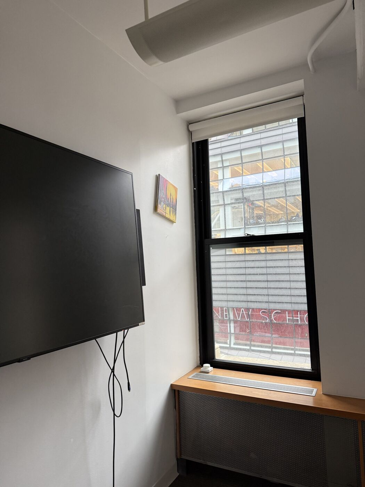
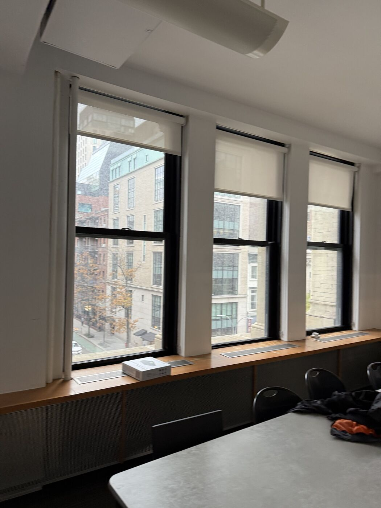
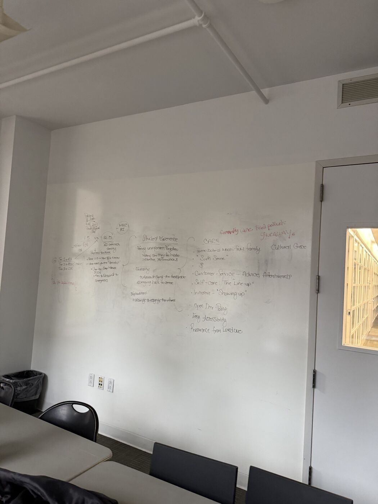
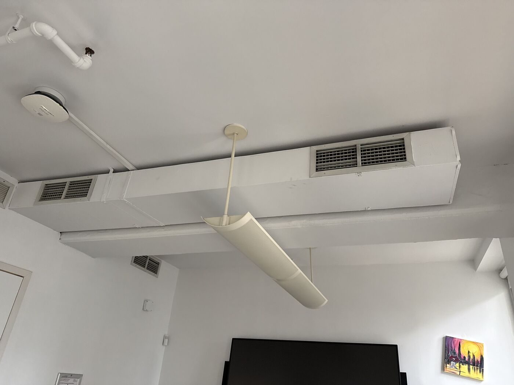
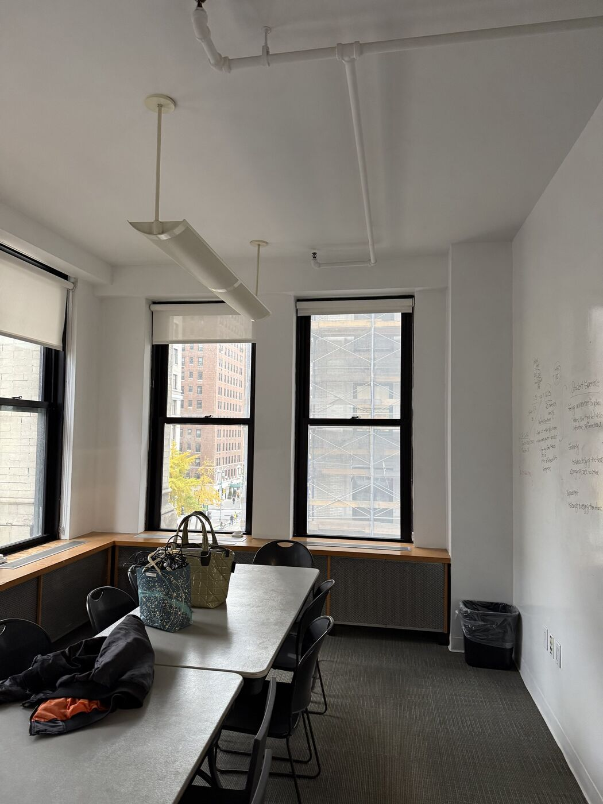

# Room 401

Room 401 at The New School, 72 Fifth Avenue, is a corner meeting room on the fourth
floor: very roughly 6.5 x 4.5 m (to be measured), windows on two walls, a glossy
whiteboard wall, and a short wall with a mounted NEC screen and the door.

## Floor plan

## The plan in one minute

- **Picture:** the room's own NEC wall screen, fed by the Pi through the screen's
  "Laptop HDMI-1" cable. Visits start at noon and the window shades are thin, and a
  screen stays black in daylight where a projector would turn grey. It also looks like
  an ordinary meeting-room screen that starts watching you.
- **Darkness:** black flame-retardant theatre fabric (duvetyne) on spring tension rods in
  each of the six window recesses. Nothing screwed or taped to the building. Lights off.
- **Sound:** one powered speaker on the floor beside the screen; the screen's own thin
  speakers stay silent.
- **Listening:** a directional (cardioid) USB microphone 30 to 50 cm in front of the
  visitor's spot.
- **Seeing:** a USB webcam on top of the screen, where every conference camera sits.
- **The Pi:** in its stone case, low on the screen wall, next to power. Every cable
  stays under 1.5 m.
- **The visitor:** comes in through the door, takes two steps into the dark and stands
  on a dim floor mark about 2 m from the screen. One chair stays; everything else
  leaves the room.

## Photos

| | |
|---|---|
|  |  |
| The screen wall, seen from the far end | The NEC screen and the window corner |
|  |  |
| The long window wall: deep recesses, radiators under the sills | The whiteboard wall (too glossy to project on) |
|  |  |
| Ceiling: pendant lights, sprinkler pipes, supply duct | Looking toward the far windows |

## Rules we keep in the room

- Hang nothing from the sprinkler pipes or the ceiling.
- Don't open or replug the school's AV rack, and don't use the school's data jacks.
- Keep the radiator grilles and the door clear; a 1 m path from door to spot.
- Agree the volume with the school and mark it on the speaker.
