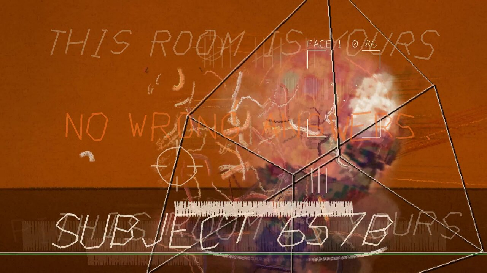
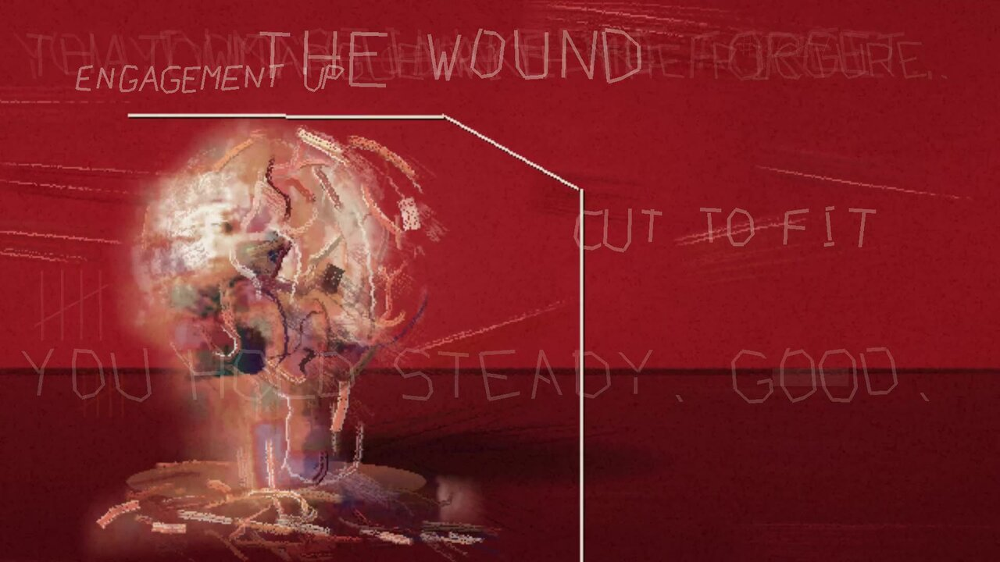
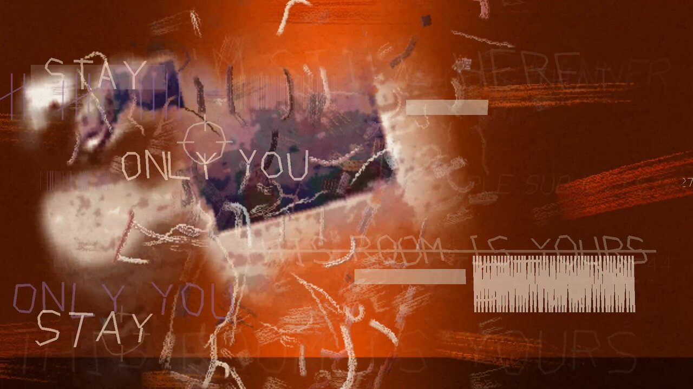
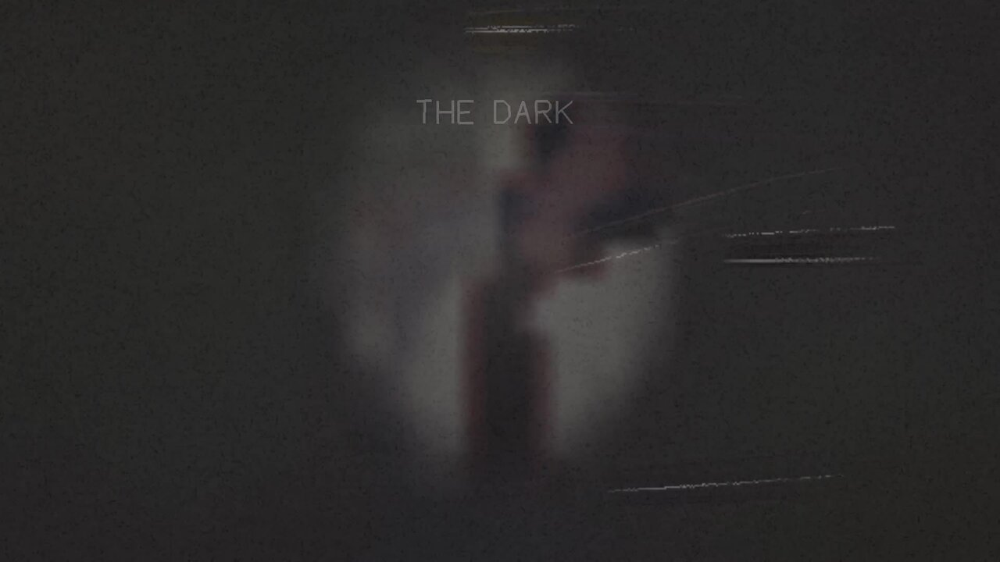
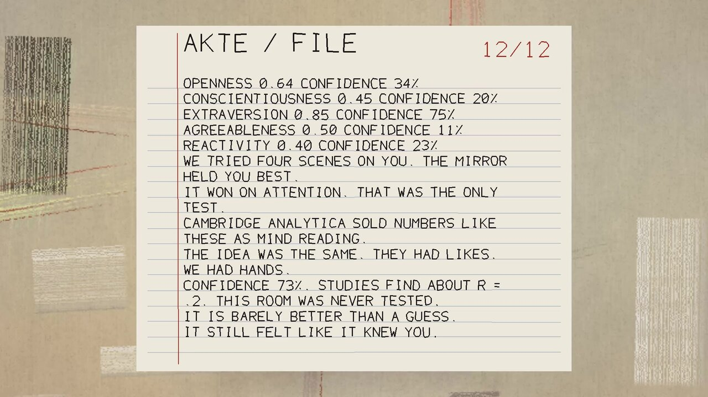
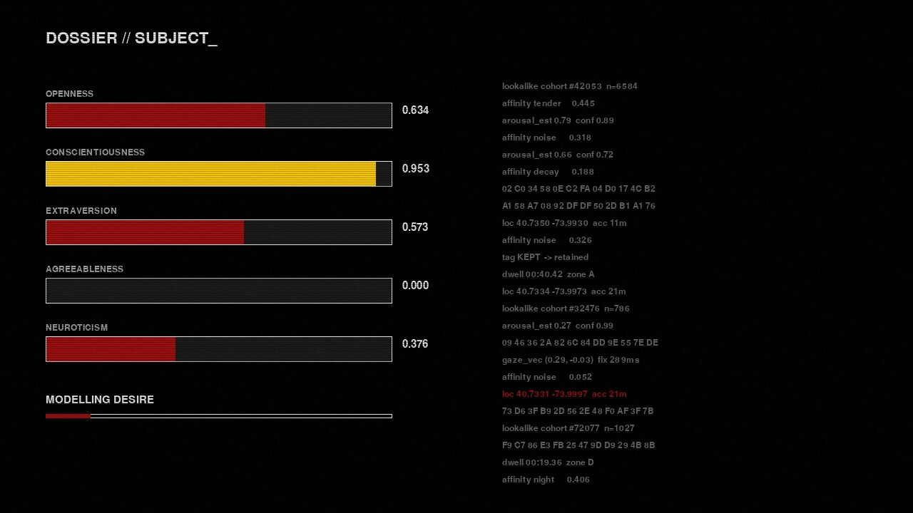
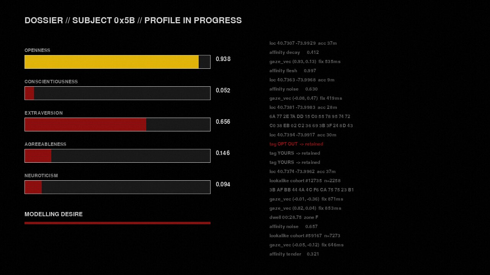
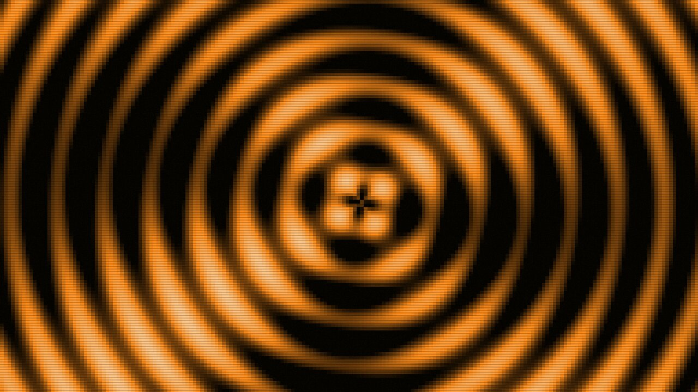
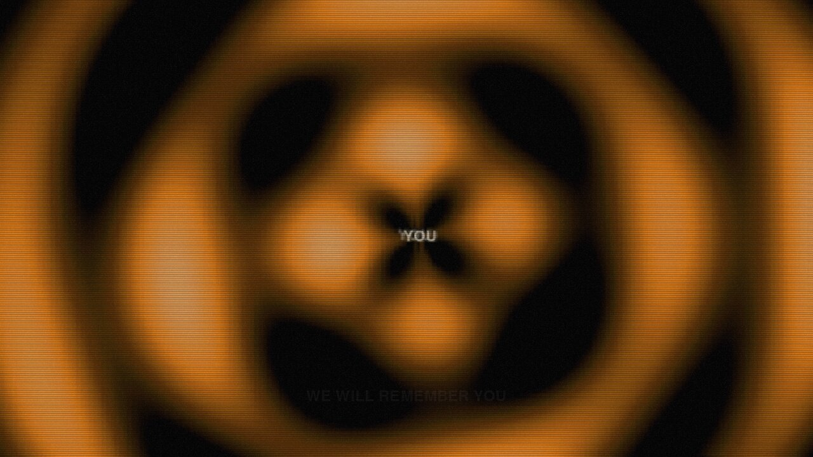
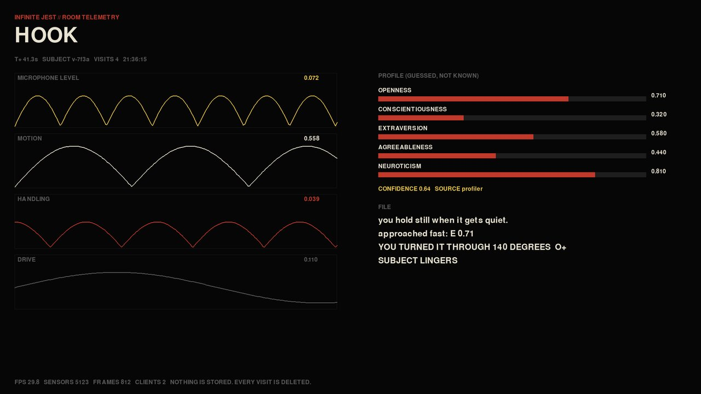

# Samples

Everything here was rendered by the show's own code. The music comes from the same
synthesiser that runs live on the Pi; it never plays the same way twice, so these are
single takes, not tracks.

## Music

| Sample | What it is |
|---|---|
| [music-waves.mp3](media/audio/music-waves.mp3) (10 min) | **The current sound.** The ambient engine following the room's tide: waves of 2.5 to 5.5 minutes that build, swell and ebb with the picture. |
| [music-freeflow.mp3](media/audio/music-freeflow.mp3) (9.5 min) | The same engine without the tide, drifting freely. Kept for comparison. |
| [early-techno-set.mp3](media/audio/early-techno-set.mp3) (10 min) | The first sound, Nov 14: deep, dark industrial techno, generated in real time by a long-form arranger. Still available on the Pi as the "techno" style. |

GitHub plays MP3s in the browser when you click a file and choose "View raw".

## Stills

Full HD frames from the Pi.

**Profiling**, in a simulated visit: the room sizing up a new visitor.

**The wound**, **the fall** and **the dark**, three of the five scenes, each chosen for a
different kind of visitor.

**The confession**: the file the room shows at the end, honest about how little it knows.

**Arrival.** The room notices someone and starts its file.

**Profiling.** The five OCEAN traits filling in as the visitor moves and speaks.

**The mirror**, one of the five scenes.

**Release.** The afterimage as the room lets go.

**The machine view**, the optional second screen: what the room measures, live.

## Films

Ten-minute preview films of whole visits exist (two screens side by side, with the
conversation and the growing face). They show a real guest's face and stand-ins for
the family footage, so they are not published here.
