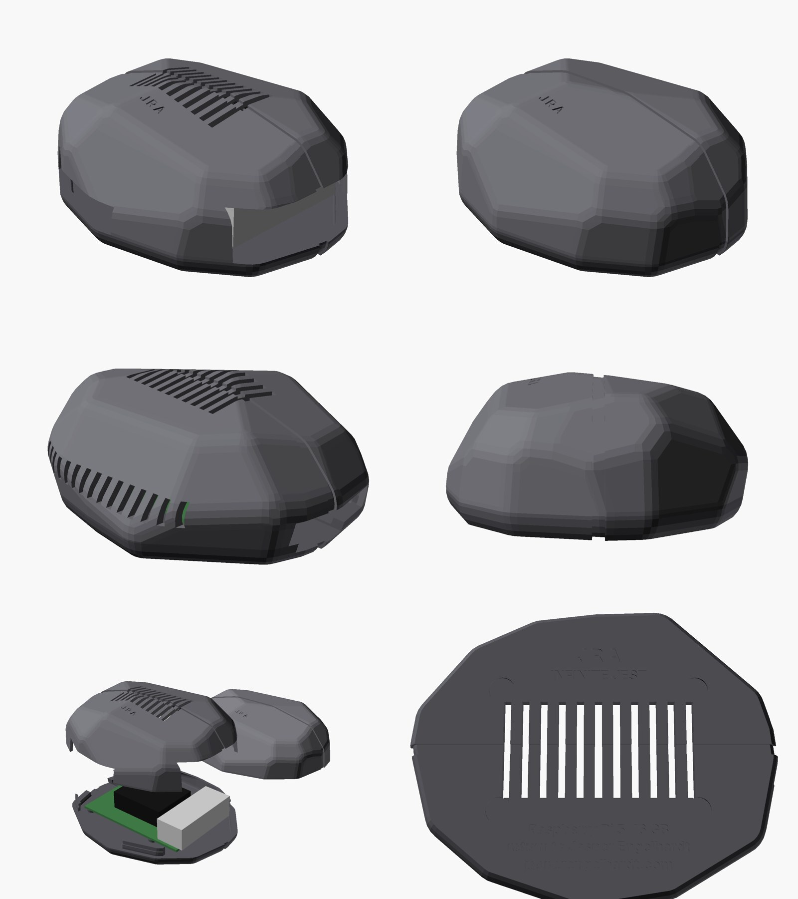
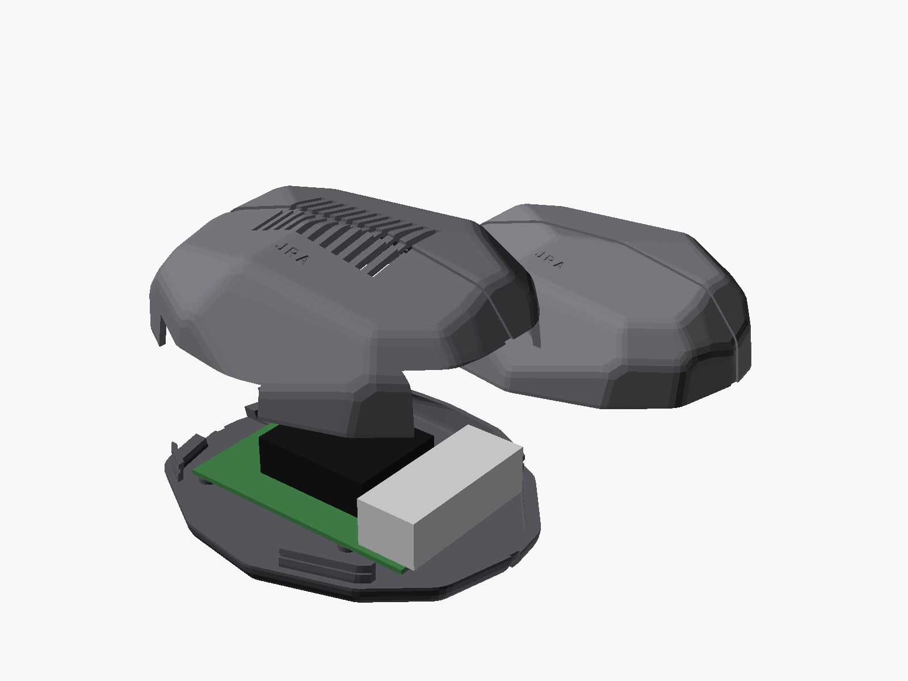
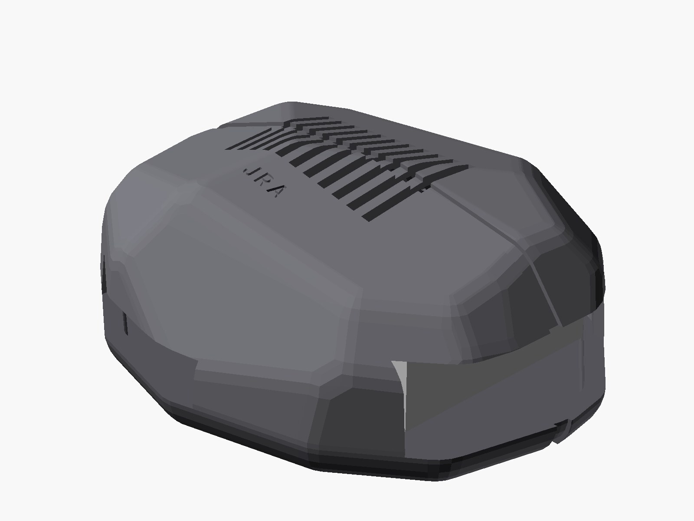
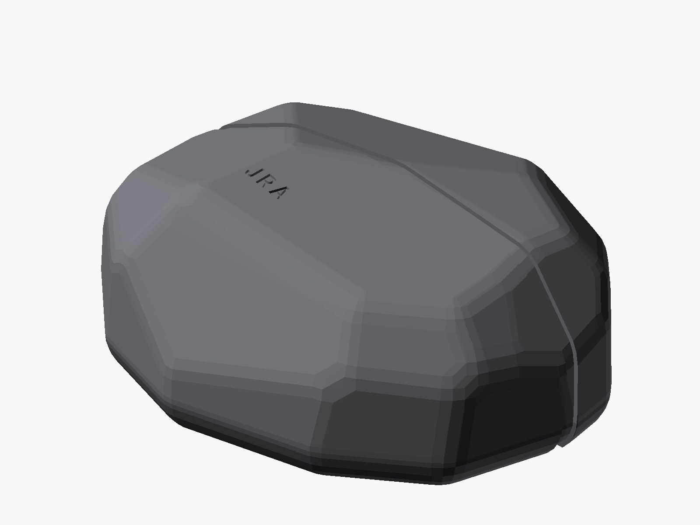
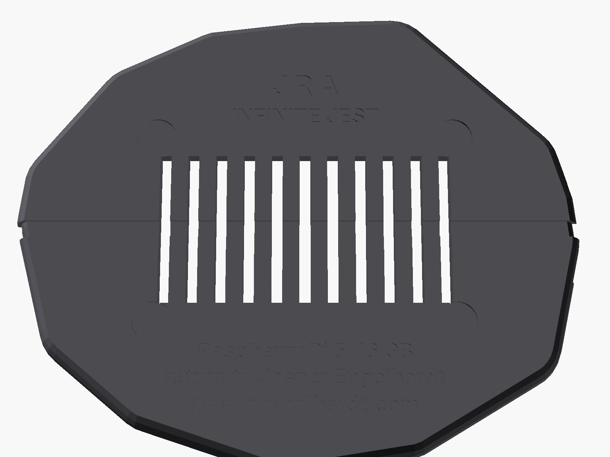

# The shell: "Stone"

The Pi lives in a faceted pebble: about 30 slightly rounded facets, an uneven top and
one flat bottom. It is made to be practical first: good for the Pi, nice in the hand,
safe in a bag. Version 3, Nov 24, 2026.



## Three parts

| Part | Size | What it is |
|---|---|---|
| Tray | 122 x 101 x 13 mm | The Pi screws onto it. Air slots in the floor, microSD slot underneath. |
| Work shell | 121 x 100 x 40 mm | Clicks on for the show. All connectors open, ventilation slits over the fan. |
| Travel shell | 125 x 102 x 40 mm | Clicks on for the bag. Closed, protects the ports. |

| | |
|---|---|
|  |  |
| Tray, Pi and the two shells | Work shell on: ports and vents open |
|  |  |
| Travel shell on | Under the tray: air slots and marks |

**Openings (work shell).** Port end: 4 x USB, Ethernet. Long side: USB-C power,
micro-HDMI 0 and 1. microSD end: power button and status LEDs. Roof: vents over the
Active Cooler.

**The click.** The tray rim has a groove; small ridges inside each shell snap into it.
Push straight down to close, pull straight up to open.

**New in v3: the band groove.** A fine channel (3.5 mm wide, 0.9 mm deep) runs once round
the stone the long way, over the top and under the tray. A hair tie or rubber band in
it keeps the shell shut in a bag.

**Marks.** J R A pressed into the top of each shell. Under the tray: J R A, INFINITE JEST,
the Pi model and a return address.

## Printing

- PETG or ASA in matte black (not PLA, which softens next to a warm Pi).
- 0.12 mm layers, 4 walls, 20% gyroid infill.
- Shells print rim down with tree supports from the build plate only, touching just the
  inside of the top, so no outside face is marked. Bed at least 130 x 110 mm.
- Test first: print the tray and the travel shell and try the click. Too tight: set
  `clr = 0.35` in `stone.scad`. Too loose: `bump_d = 0.7`.
- Hardware: 4 x M2.5 x 6 mm self-tapping screws (or heat-set inserts), 4 rubber feet,
  one hair tie.

## Files

In `infinite_jest/case/print/` on the case branch
([pull request #6](https://github.com/Grossi-thisisforyou/read_the_room/pull/6)):
`stone.scad` (OpenSCAD source; change `seed` for a differently cut stone),
`stone_tray.stl`, `stone_work.stl`, `stone_travel.stl` and `stone_PRINT_SPEC.txt`.

```
openscad -D 'part="tray"'   -o stone_tray.stl   stone.scad
openscad -D 'part="work"'   -o stone_work.stl   stone.scad
openscad -D 'part="travel"' -o stone_travel.stl stone.scad
```

Port positions come from the official Pi 5 drawings and still need a check on a first
print.

## Boot splash

The same folder holds the boot look: a black Plymouth theme "infinitejest", a matching
console palette and login prompt, with install, preview and uninstall scripts.
